<div align="center">

# 🩺 Self-Healing Data Pipeline Platform
### *Autonomous Data Quality Gating • Deterministic Failure Classification • Policy-Driven Remediation • dbt Analytics*

[](https://www.python.org/)
[](https://fastapi.tiangolo.com/)
[](https://www.postgresql.org/)
[](https://www.getdbt.com/)
[](https://airflow.apache.org/)
[](https://react.dev/)
[](https://www.typescriptlang.org/)
[](https://prometheus.io/)
[](https://grafana.com/)
[](https://www.docker.com/)
[](https://opensource.org/licenses/MIT)

<br/>

**[Architecture](#-system-architecture)** •
**[Core Guarantees](#-core-architectural-guarantees)** •
**[Failure Taxonomy](#-failure-classification-taxonomy)** •
**[Quick Start](#-quick-start-guide)** •
**[Failure Injection Suite](#-failure-injection-demo)** •
**[dbt Models](#-dbt-transformation-layer)** •
**[API Docs](#-rest-api-reference)** •
**[Dashboard](#-frontend-dashboard-tour)**

</div>

---

## 🌟 Executive Overview

Modern data pipelines are brittle. Schema drifts break transformations, sudden volume drops distort dashboards, duplicate batch deliveries pollute analytics, and malformed records cause silent downstream errors. Most traditional data engineering platforms react only *after* pipelines crash or downstream dashboards report corrupted numbers.

The **Self-Healing Data Pipeline Platform** is an enterprise-grade, production-inspired platform designed to operate **autonomously and safely**:
1. It ingests continuous data batches across multiple enterprise domains (**Customers**, **Inventory**, **Orders**).
2. It validates incoming records against **multi-dimensional quality contracts** (completeness, uniqueness, validity, schema contracts, statistical distributions).
3. It maps detected violations and system anomalies into a **deterministic 9-category failure taxonomy**.
4. It resolves anomalies using **policy-governed remediation actions** (deterministic deduplication, non-blocking schema evolution, and row-level quarantining).
5. It enforces strict **Post-Recovery Verification**: a pipeline run is *never* marked healed unless the affected quality rules are re-evaluated and pass cleanly on the repaired dataset.
6. It compiles clean, validated data into production-ready star-schema marts using **dbt Core**, providing continuous telemetry to **FastAPI**, **React 19**, **Prometheus**, and **Grafana**.

---

## 🛡️ Core Architectural Guarantees

> [!IMPORTANT]
> ### 1. Zero Silent Data Corruption or Loss
> The platform **never silently modifies or discards data**. When records fail business validation (e.g. malformed emails, negative order amounts, or missing primary keys), they are isolated into an auditable cryptographic **Quarantine Vault** with complete JSON provenance, timestamping, and rejection rationale.

> [!TIP]
> ### 2. Verification Before Healed Status
> Retrying a job or running a deduplication script is not considered recovery. The platform executes **Post-Recovery Verification**: the exact failed rules are re-executed on the remediated batch in memory. Only if the error count reaches exactly zero is the incident marked `RESOLVED` and the run marked `HEALED`.

> [!WARNING]
> ### 3. Human-in-the-Loop Safe Escalation
> Healing is governed by 3 safety tiers: `AUTOMATIC`, `REQUIRES_APPROVAL`, and `MANUAL_ONLY`. Destructive actions, breaking schema changes (e.g. dropped required columns), and extreme statistical distribution anomalies ($|z| > 3.0$) automatically pause downstream publication, open an escalated incident, and wait for human review via the dashboard.

> [!NOTE]
> ### 4. Cryptographic Ingestion Idempotency
> Ingestion batches calculate SHA-256 checksums over source content and timestamp bounds. Re-processing identical files or accidental duplicate cron runs will never insert duplicate rows or open duplicate incidents.

---

## 📐 System Architecture

```mermaid
flowchart TD
    subgraph S["1. Multi-Domain Data Sources"]
        CS["customers.csv<br/>(500 records)"]
        OR["orders.csv<br/>(1,000 records)"]
        INV["inventory.csv<br/>(100 records)"]
    end

    subgraph ING["2. Ingestion & Raw Landing"]
        Ingester["Base Ingester Engine<br/>• SHA-256 Batch Checksum<br/>• Idempotent Token Guard<br/>• Row & Batch Metadata Tracking"]
        RawDB[("PostgreSQL: raw_data<br/>• raw_customers<br/>• raw_orders<br/>• raw_inventory")]
    end

    subgraph DQ["3. Quality Engine & Anomaly Monitor"]
        QEngine["Quality Engine<br/>• Completeness & Null Rates<br/>• Primary Key Uniqueness<br/>• Regex & Min-Value Validity<br/>• Additive & Breaking Schema"]
        StatMonitor["Statistical Profile Monitor<br/>• Batch Volume Spikes/Drops<br/>• Historical Mean & StdDev<br/>• Dynamic z-score (|z| > 3.0)"]
    end

    subgraph CLASS["4. Deterministic Failure Classifier"]
        Classifier["Classification Engine<br/>Maps Signals to 9 Deterministic Taxonomies<br/>Assigns Severity: INFO | WARNING | ERROR | CRITICAL"]
    end

    subgraph HEAL["5. Policy-Governed Recovery Engine"]
        Matcher["Policy Matcher<br/>Evaluates Preconditions & Safety Tiers"]
        Strategies["Recovery Strategies:<br/>• Deduplicate (retaining latest timestamp)<br/>• Quarantine Missing Business Keys<br/>• Quarantine Invalid Records<br/>• Non-blocking Additive Schema Evolution"]
        QuarantineDB[("Quarantine Vault<br/>pipeline_metadata.quarantined_records")]
        Verifier["Post-Recovery Verifier<br/>Re-evaluates Failed Rules on Remediated Data"]
    end

    subgraph TRANS["6. dbt Core Transformation Layer"]
        DBT["dbt Core (dbt-postgres)<br/>• Staging Views (quarantine-filtered)<br/>• Star-Schema Dimensional Marts<br/>• 19 Uniqueness & Relationship Tests"]
        MartsDB[("PostgreSQL: analytics_data<br/>• dim_customers<br/>• dim_products<br/>• fct_orders<br/>• fct_inventory_levels")]
    end

    subgraph OBS["7. Observability & Presentation"]
        API["FastAPI REST Backend<br/>Swagger UI • OpenAPI • /metrics"]
        UI["React 19 + TypeScript SPA<br/>Live KPI Overview • Pipeline Controls<br/>Data Quality Matrix • Incidents Queue<br/>Quarantine Vault Explorer"]
        Prom["Prometheus Engine<br/>SLA Rule Evaluation & Metrics Scrapes"]
        Graf["Grafana Dashboard<br/>8 Real-Time Operational Panels"]
    end

    S --> Ingester
    Ingester --> RawDB
    RawDB --> QEngine
    RawDB --> StatMonitor
    QEngine -- "Rule Violations" --> Classifier
    StatMonitor -- "Statistical Drift" --> Classifier
    Classifier --> Matcher
    Matcher --> Strategies
    Strategies -- "Isolated Bad Rows" --> QuarantineDB
    Strategies --> Verifier
    Verifier -- "Verified Clean" --> DBT
    QEngine -- "All Passed" --> DBT
    DBT --> MartsDB
    MartsDB --> API
    RawDB --> API
    QuarantineDB --> API
    API --> UI
    API --> Prom
    Prom --> Graf

    classDef sourceNode fill:#2d3748,stroke:#4a5568,stroke-width:2px,color:#fff;
    classDef engineNode fill:#1a365d,stroke:#2b6cb0,stroke-width:2px,color:#fff;
    classDef healNode fill:#22543d,stroke:#38a169,stroke-width:2px,color:#fff;
    classDef dbNode fill:#44337a,stroke:#6b46c1,stroke-width:2px,color:#fff;
    classDef obsNode fill:#744210,stroke:#d69e2e,stroke-width:2px,color:#fff;

    class CS,OR,INV sourceNode;
    class Ingester,QEngine,StatMonitor,Classifier,DBT engineNode;
    class Matcher,Strategies,Verifier healNode;
    class RawDB,QuarantineDB,MartsDB dbNode;
    class API,UI,Prom,Graf obsNode;
```



---

## 🗂️ PostgreSQL Data Architecture

The storage layer is partitioned into **four decoupled database schemas**, ensuring clear separation between operational orchestration, raw landing data, clean staging transformations, and curated analytical marts:

```
PostgreSQL Database: self_healing_platform
│
├── 📁 pipeline_metadata (Operational Engine & Audit Trail)
│   ├── pipelines                   # Registered pipeline metadata & schedules
│   ├── pipeline_runs               # Execution run statuses, durations, trigger types
│   ├── ingestion_batches           # Batch IDs, SHA-256 tokens, row count audit
│   ├── dataset_schemas             # Versioned schema contracts (v1, v2, etc.)
│   ├── data_quality_rules          # Configurable rules (completeness, uniqueness, validity)
│   ├── validation_results          # Granular check results, observed values, thresholds
│   ├── detected_anomalies          # Volume shifts, numeric outliers, z-scores
│   ├── failure_incidents           # Incident tracker with severity & actions
│   ├── recovery_policies           # Safety levels, retry limits, preconditions
│   ├── recovery_attempts           # Remediation logs, timings, post-verification verdicts
│   ├── quarantined_records         # Isolated invalid records with JSON payloads
│   └── audit_events                # Immutable event log of system operations
│
├── 📁 raw_data (Raw Landing Zone)
│   ├── raw_customers               # Raw customer ingest with _batch_id and _ingested_at
│   ├── raw_orders                  # Raw orders ingest with _batch_id and _ingested_at
│   └── raw_inventory               # Raw inventory ingest with _batch_id and _ingested_at
│
├── 📁 staging_data (dbt Staging Views)
│   ├── stg_customers               # Clean typed view; filters out quarantined records
│   ├── stg_orders                  # Clean typed view; filters out quarantined records
│   └── stg_inventory               # Clean typed view; filters out quarantined records
│
└── 📁 analytics_data (Curated Star-Schema Marts)
    ├── dim_customers               # Customer dimensional table with spend metrics
    ├── dim_products                # Product catalog with category attributes
    ├── fct_orders                  # Core sales transactions with foreign key joins
    └── fct_inventory_levels        # Warehouse stock levels and restocking alerts
```

---

## 🩺 Failure Classification Taxonomy

Every operational anomaly is deterministically assigned to one of nine categories:

| Category | Description | Severity | Automated Strategy | Safety Level | Post-Verification |
|---|---|---|---|---|---|
| **`MISSING_DATA`** | Null rate exceeds threshold or mandatory ID missing | `ERROR` / `CRITICAL` | `quarantine_missing_records`: Isolates records lacking primary keys | `AUTOMATIC` | Re-checks null percentage on clean rows |
| **`DUPLICATE_DATA`** | Duplicate primary or natural business keys detected | `ERROR` / `CRITICAL` | `deduplicate_retaining_latest`: Keeps latest timestamp; quarantines older copies | `AUTOMATIC` | Verifies duplicate count == 0 |
| **`SCHEMA_DRIFT`** | New additive column or breaking column removal/type alteration | `INFO` / `CRITICAL` | `adopt_additive_columns`: Upgrades schema registry to $v_{n+1}$ & alters raw table | `AUTOMATIC` (Additive)<br/>`REQUIRES_APPROVAL` (Breaking) | Re-evaluates schema contract |
| **`DISTRIBUTION_ANOMALY`** | Batch volume or metric mean deviates significantly ($|z| > 3.0$) | `WARNING` | `pause_downstream_and_request_approval`: Pauses dbt execution | `REQUIRES_APPROVAL` | Operator reviews historical z-score baseline |
| **`INVALID_RECORDS`** | Business rule violation (e.g. negative amount, malformed email) | `ERROR` | `quarantine_invalid_rows`: Routes invalid records to quarantine vault | `AUTOMATIC` | Re-evaluates validity rule on clean rows |
| **`INGESTION_FAILURE`** | Malformed CSV, truncated file, or missing source file | `CRITICAL` | `retry_ingestion_or_check_source`: Exponential backoff retry | `AUTOMATIC` | Verifies file integrity & parse check |
| **`TRANSFORMATION_FAILURE`** | dbt compilation error or relational test failure | `CRITICAL` | `halt_and_preserve_logs`: Preserves compilation logs | `MANUAL_ONLY` | Re-runs dbt test suite |
| **`INFRASTRUCTURE_OR_TIMEOUT`** | Database connection dropped or network timeout | `CRITICAL` | `retry_with_backoff`: Re-establishes connection pool | `AUTOMATIC` | Connection health ping |
| **`UNKNOWN_FAILURE`** | Unhandled exception or unexpected runtime fault | `CRITICAL` | `escalate_for_human_investigation`: Full stack trace logged | `MANUAL_ONLY` | Operator diagnostic |

---

## 🧪 Failure Injection Demo

The repository includes an automated failure injection test suite (`scripts/inject_failures.py`) that executes 6 realistic corruptions to demonstrate real-time detection, remediation, and verification:

```powershell
$env:PYTHONPATH="backend"
python scripts/inject_failures.py
```

### 📊 Live Injection Results Matrix

```
================================================================================
                      FAILURE INJECTION TEST MATRIX                      
================================================================================
Scenario                           | Detected | Category             | Status      
--------------------------------------------------------------------------------
Missing Required Values            | YES      | MISSING_DATA         | HEALED      
Duplicate Primary Keys             | YES      | DUPLICATE_DATA       | HEALED      
Additive Schema Drift              | YES      | SCHEMA_DRIFT         | HEALED      
Breaking Schema Drift              | YES      | INVALID_RECORDS      | ESCALATED   
Statistical Distribution Anomaly   | YES      | DISTRIBUTION_ANOMALY | ESCALATED   
Invalid Records (Negative Amounts) | YES      | INVALID_RECORDS      | HEALED      
================================================================================
```

### Detailed Scenario Walkthrough:
1. **Missing Required Values**: 50 customer records injected with blank `customer_id`.
   - *Detection*: `cust_req_id` rule fails (null rate: 10.0%, threshold: 0.0%).
   - *Healing*: Quarantines 50 rows into `quarantined_records`.
   - *Post-Verification*: Target rule re-evaluated against the 450 clean records $\rightarrow$ **0 violations**.
   - *Result*: Pipeline status updated to **`HEALED`**, dbt transformations run successfully.
2. **Duplicate Primary Keys**: 50 duplicated `order_id` records added with staggered timestamps.
   - *Detection*: `ord_unique_id` rule fails with 100 duplicate keys.
   - *Healing*: Deduplicates by `order_id`, preserving the record with the most recent `order_date`.
   - *Post-Verification*: Uniqueness check re-evaluated on 1,000 clean records $\rightarrow$ **0 duplicates**.
   - *Result*: Pipeline status updated to **`HEALED`**, dbt transformations run successfully.
3. **Additive Schema Drift**: Added nullable `loyalty_tier` column to `customers.csv`.
   - *Detection*: Schema contract flags unexpected column `loyalty_tier` (`is_breaking=False`).
   - *Healing*: Schema registry updated to version 2; non-blocking `ALTER TABLE` executed on `raw_customers`.
   - *Result*: Pipeline status updated to **`HEALED`**, dbt transformations run successfully.
4. **Breaking Schema Drift**: Dropped mandatory `email` column from `customers.csv`.
   - *Detection*: Missing required column flags `is_breaking=True`.
   - *Safety Gate*: Policy requires human approval; downstream dbt publication is halted.
   - *Result*: Pipeline status set to **`ESCALATED`**.
5. **Statistical Distribution Anomaly**: Order amounts multiplied by 25x.
   - *Detection*: Profile monitor detects observed mean of $17,314.50 vs baseline mean of $692.58 ($z = +35.2$).
   - *Safety Gate*: Action set to `pause_downstream_and_request_approval`.
   - *Result*: Pipeline status set to **`ESCALATED`**.
6. **Invalid Records**: Injected 35 negative amounts (`-$35.58` to `-$143.03`) into `orders.csv`.
   - *Detection*: `ord_pos_amount` validity check fails with 35 invalid rows.
   - *Healing*: Quarantines the 35 invalid rows into `quarantined_records`.
   - *Post-Verification*: Validity check re-evaluated on 965 clean rows $\rightarrow$ **0 invalid rows**.
   - *Result*: Pipeline status updated to **`HEALED`**, dbt transformations run successfully.

---

## 📊 dbt Transformation Layer

The platform uses **dbt Core** (`dbt-postgres`) to transform raw data into analytics-ready models:

```
dbt_project/
├── models/
│   ├── staging/
│   │   ├── stg_customers.sql        # Deduplicated customer records excluding quarantine
│   │   ├── stg_orders.sql           # Type-casted orders excluding quarantine
│   │   ├── stg_inventory.sql        # Inventory status excluding quarantine
│   │   └── schema.yml               # Source tests & documentation
│   └── marts/
│       ├── dim_customers.sql        # Customer dimension with lifetime metrics
│       ├── dim_products.sql         # Product dimension with warehouse mapping
│       ├── fct_orders.sql           # Fact table joined to customer & product dimensions
│       ├── fct_inventory_levels.sql # Fact table tracking stock and reorder urgency
│       └── schema.yml               # Mart constraints & relationship tests
```

### dbt Test Coverage (19 Tests Passing):
- **Uniqueness Tests**: `customer_id`, `product_id`, `order_id`.
- **Not-Null Constraints**: All primary keys, dates, and amounts.
- **Accepted Values**: Order statuses (`COMPLETED`, `PROCESSING`, `SHIPPED`, `DELIVERED`, `CANCELLED`).
- **Referential Integrity**: `fct_orders.customer_id` $\rightarrow$ `dim_customers.customer_id`, `fct_orders.product_id` $\rightarrow$ `dim_products.product_id`.

```powershell
dbt test --profiles-dir dbt_project --project-dir dbt_project
# PASS=19 WARN=0 ERROR=0 TOTAL=19
```

---

## 🖥️ Frontend Dashboard Tour

The dashboard is built with **React 19**, **TypeScript**, and **Vite**, featuring real-time auto-polling every 15 seconds:

```
┌────────────────────────────────────────────────────────────────────────────────────────┐
│  🩺 SELF-HEALING DATA PLATFORM       [● System Healthy]   [Postgres: Connected]        │
├────────────────────────────────────────────────────────────────────────────────────────┤
│  [Overview]    [Pipelines]    [Data Quality]    [Incidents (1)]    [Recovery Vault]    │
├────────────────────────────────────────────────────────────────────────────────────────┤
│                                                                                        │
│   ┌───────────────────┐ ┌───────────────────┐ ┌───────────────────┐ ┌────────────────┐ │
│   │ Quality Health    │ │ Active Pipelines  │ │ Total Executions  │ │ Recovery Rate  │ │
│   │      96.8%        │ │         3         │ │        28         │ │     100.0%     │ │
│   │  ▲ 1.2% this hour │ │  All Active       │ │  22 Healed / 6 OK │ │  Verified 0 err│ │
│   └───────────────────┘ └───────────────────┘ └───────────────────┘ └────────────────┘ │
│                                                                                        │
│  Active Pipeline Status                                                                │
│  ┌─────────────────────────────┬─────────────┬──────────────┬──────────────┬─────────┐ │
│  │ Pipeline                    │ Last Run    │ Status       │ Duration     │ Action  │ │
│  ├─────────────────────────────┼─────────────┼──────────────┼──────────────┼─────────┤ │
│  │ customers_pipeline          │ 2 mins ago  │ ● HEALED     │ 1,420 ms     │ Trigger │ │
│  │ e_commerce_orders_pipeline  │ 5 mins ago  │ ● HEALED     │ 2,150 ms     │ Trigger │ │
│  │ inventory_pipeline          │ 12 mins ago │ ● COMPLETED  │ 890 ms       │ Trigger │ │
│  └─────────────────────────────┴─────────────┴──────────────┴──────────────┴─────────┘ │
│                                                                                        │
│  Recent Operational Incidents & Heals                                                  │
│  • [HEALED]    DUPLICATE_DATA in orders: 50 duplicates resolved (kept latest)          │
│  • [HEALED]    INVALID_RECORDS in orders: 35 negative amounts moved to quarantine vault │
│  • [ESCALATED] DISTRIBUTION_ANOMALY in orders: amount_mean z-score +35.2 (Paused)      │
└────────────────────────────────────────────────────────────────────────────────────────┘
```

### Dashboard Pages:
1. **Overview**: Executive KPIs (Platform Quality Score, Active Pipelines, Total Executions, Recovery Rate), system health indicator, and live activity stream.
2. **Pipelines**: Interactive cards to manually trigger runs, view duration trends, and inspect batch-level row counts.
3. **Data Quality**: Real-time quality score banner, active statistical anomalies table with z-scores, and rule execution matrix.
4. **Incidents**: Queue of open, healing, resolved, and escalated incidents. Features a **Dry-Run Modal** that previews remediation actions before applying them, plus human **Approve** and **Retry** controls.
5. **Recovery Vault**: History of remediation attempts (duration, strategy, verification details) and a searchable explorer for all isolated `quarantined_records`.

---

## 📈 Observability: Prometheus & Grafana

The platform includes production-grade observability out of the box:

### Key Prometheus Metrics:
- `pipeline_runs_total{pipeline_id, status}`: Counter tracking completed, healed, and escalated executions.
- `pipeline_execution_duration_seconds`: Latency histogram across each stage of execution.
- `ingestion_rows_processed_total{dataset}`: Cumulative volume of processed records.
- `quality_checks_total{dataset, passed}`: Count of rule evaluations partitioned by outcome.
- `incidents_by_category_total{category, severity}`: Incident occurrence rate by category.
- `recovery_attempts_total{strategy, status}`: Recovery success and failure counters.
- `active_incidents{status}`: Real-time gauge of open incidents.

### Grafana Dashboard (`monitoring/grafana/dashboards/self_healing_overview.json`):
1. **Pipeline Runs by Status** (Stat counter with status breakdown)
2. **Open Incidents Requiring Human Review** (Color-coded alert stat)
3. **Recovery Success Rate** (Gauge showing remediation percentage)
4. **Active Incidents Gauge** (Current open vs resolved)
5. **Ingestion Throughput** (Rows/sec time series by dataset)
6. **Quality Rule Checks** (Bar chart: Passed vs Failed)
7. **Pipeline Latency** ($p_{95}$ execution duration)
8. **Detected Failures by Category** (Pie chart distribution)

---

## 🚀 Quick Start Guide

### Prerequisites
- **Python**: 3.11 or 3.12
- **PostgreSQL**: 16+ or 18 running on port 5432
- **Node.js**: 20+ and npm

### Local Setup (PowerShell / Windows)

```powershell
# 1. Clone the repository
git clone https://github.com/your-username/self-healing-data-pipeline.git
cd "self-healing-data-pipeline"

# 2. Configure environment variables
Copy-Item .env.example .env

# 3. Install Python dependencies
pip install -r backend/requirements.txt

# 4. Initialize PostgreSQL schemas & tables
psql -U postgres -h 127.0.0.1 -d self_healing_platform -f scripts/init_db.sql

# 5. Seed initial pipelines, quality rules, and recovery policies
$env:PYTHONPATH="backend"
python scripts/seed_metadata.py

# 6. Generate clean synthetic datasets
python scripts/generate_synthetic_data.py

# 7. Run automated test suite (39 tests)
pytest backend/tests/ -v --tb=short

# 8. Start the FastAPI backend
uvicorn app.main:app --host 0.0.0.0 --port 8000 --reload
```

In a separate terminal, launch the React frontend:

```powershell
cd frontend
npm install
npm run dev
```

- **Frontend Dashboard**: [http://localhost:5173](http://localhost:5173)
- **FastAPI OpenAPI Swagger Docs**: [http://localhost:8000/docs](http://localhost:8000/docs)
- **Prometheus Telemetry Scrape**: [http://localhost:8000/metrics](http://localhost:8000/metrics)

---

### Docker Compose Deployment (1-Click)

To run all services containerized (PostgreSQL, FastAPI backend, React frontend, Prometheus, Grafana):

```bash
docker compose up -d --build
```

Endpoints:
- **Web UI**: [http://localhost:3000](http://localhost:3000)
- **API & Docs**: [http://localhost:8000/docs](http://localhost:8000/docs)
- **Prometheus Server**: [http://localhost:9090](http://localhost:9090)
- **Grafana Dashboards**: [http://localhost:3001](http://localhost:3001) *(login: `admin` / `admin`)*

---

## 📡 REST API Reference

| Method | Endpoint | Description |
|---|---|---|
| `GET` | `/api/v1/health` | Comprehensive system health check (DB connection & storage) |
| `GET` | `/api/v1/pipelines` | List all registered data pipelines |
| `POST` | `/api/v1/pipelines/{pipeline_id}/run` | Manually trigger an end-to-end pipeline run |
| `GET` | `/api/v1/runs` | List execution runs with status and duration filters |
| `GET` | `/api/v1/runs/{run_id}` | Detailed telemetry and batch metadata for a run |
| `GET` | `/api/v1/quality/score` | Overall platform data quality score (0 - 100%) |
| `GET` | `/api/v1/quality/results` | Paginated quality rule check results |
| `GET` | `/api/v1/quality/anomalies` | Detected statistical volume and metric anomalies |
| `GET` | `/api/v1/incidents` | Incident queue with category and severity filters |
| `POST` | `/api/v1/incidents/{incident_id}/retry` | Re-trigger recovery for an incident |
| `POST` | `/api/v1/recovery/dry-run` | Preview recovery action impact without modifying database state |
| `POST` | `/api/v1/recovery/{attempt_id}/approve` | Operator approval gate for escalated incidents |
| `GET` | `/api/v1/recovery/quarantine` | Searchable records in the quarantine vault |
| `GET` | `/metrics` | Prometheus metrics scrape endpoint |

---

## 🧪 Automated Testing Suite

The platform includes 39 unit and integration tests covering all critical components:

```powershell
$env:PYTHONPATH="backend"
pytest backend/tests/ -v --tb=short
```

```
backend/tests/test_api.py::test_health_check PASSED                      [  2%]
backend/tests/test_api.py::test_list_pipelines PASSED                    [  5%]
backend/tests/test_api.py::test_list_runs PASSED                         [  7%]
backend/tests/test_api.py::test_quality_score PASSED                     [ 10%]
backend/tests/test_api.py::test_metrics_scrape PASSED                    [ 12%]
backend/tests/test_classifier.py::test_classify_missing_data PASSED      [ 15%]
backend/tests/test_classifier.py::test_classify_duplicate_data PASSED    [ 17%]
backend/tests/test_classifier.py::test_classify_schema_drift_breaking PASSED [ 20%]
backend/tests/test_classifier.py::test_classify_schema_drift_additive PASSED [ 23%]
backend/tests/test_classifier.py::test_classify_invalid_records PASSED   [ 25%]
backend/tests/test_classifier.py::test_classify_distribution_anomaly PASSED [ 28%]
backend/tests/test_classifier.py::test_classify_timeout_exception PASSED [ 30%]
backend/tests/test_classifier.py::test_classify_ingestion_exception PASSED [ 33%]
backend/tests/test_classifier.py::test_classify_dbt_exception PASSED     [ 35%]
backend/tests/test_classifier.py::test_classify_unknown_exception PASSED [ 38%]
backend/tests/test_quality_engine.py::test_completeness_pass PASSED      [ 41%]
backend/tests/test_quality_engine.py::test_completeness_fail_null_threshold PASSED [ 43%]
backend/tests/test_quality_engine.py::test_completeness_missing_column PASSED [ 46%]
backend/tests/test_quality_engine.py::test_uniqueness_pass PASSED        [ 48%]
backend/tests/test_quality_engine.py::test_uniqueness_fail_duplicates PASSED [ 51%]
backend/tests/test_quality_engine.py::test_uniqueness_missing_column PASSED [ 53%]
backend/tests/test_quality_engine.py::test_validity_regex_pass PASSED    [ 56%]
backend/tests/test_quality_engine.py::test_validity_regex_fail PASSED    [ 58%]
backend/tests/test_quality_engine.py::test_validity_min_value_pass PASSED [ 61%]
backend/tests/test_quality_engine.py::test_validity_min_value_fail PASSED [ 64%]
backend/tests/test_quality_engine.py::test_validity_allowed_values PASSED [ 66%]
backend/tests/test_quality_engine.py::test_schema_validation_pass PASSED [ 69%]
backend/tests/test_quality_engine.py::test_schema_missing_required_column PASSED [ 71%]
backend/tests/test_quality_engine.py::test_schema_additive_columns_allowed PASSED [ 74%]
backend/tests/test_quality_engine.py::test_schema_additive_columns_disallowed PASSED [ 76%]
backend/tests/test_recovery.py::test_deduplicate_removes_duplicates PASSED [ 79%]
backend/tests/test_recovery.py::test_deduplicate_keeps_latest PASSED     [ 82%]
backend/tests/test_recovery.py::test_deduplicate_no_duplicates PASSED    [ 84%]
backend/tests/test_recovery.py::test_deduplicate_dry_run PASSED          [ 87%]
backend/tests/test_recovery.py::test_quarantine_missing_keys PASSED      [ 89%]
backend/tests/test_recovery.py::test_quarantine_missing_keys_none_missing PASSED [ 92%]
backend/tests/test_recovery.py::test_quarantine_invalid_records PASSED   [ 94%]
backend/tests/test_recovery.py::test_quarantine_invalid_dry_run PASSED   [ 97%]
backend/tests/test_recovery.py::test_adopt_additive_schema_dry_run PASSED [100%]

======================== 39 passed, 1 warning in 0.25s ========================
```

---

## 🛠️ Technology Stack Breakdown

| Technology | Layer | Purpose |
|---|---|---|
| **Python 3.11 / 3.12** | Core Engine | High-performance backend services, data quality, and recovery logic |
| **FastAPI + Uvicorn** | REST API | Async REST API endpoints with automatic OpenAPI documentation |
| **PostgreSQL 16 / 18** | Database | Multi-schema storage: metadata, raw, staging, and analytics marts |
| **dbt Core + dbt-postgres** | Transformations | Staging views, dimensional marts, and 19 data integrity tests |
| **Apache Airflow 2.9+** | Orchestration | DAG-based workflow scheduling and anomaly monitoring |
| **Pandas & NumPy** | In-Memory Processing | Vectorized validation, profiling, and deterministic deduplication |
| **SQLAlchemy 2.0+** | ORM & Persistence | Strongly-typed model definitions, connection pooling, and transactions |
| **React 19 + TypeScript** | Web Dashboard | Modern responsive SPA with real-time telemetry polling |
| **Vite** | Frontend Build | Fast development server and optimized production bundling |
| **Prometheus** | Telemetry | Real-time metric scraping and alert rule evaluation |
| **Grafana** | Dashboards | Operational monitoring and visual telemetry |
| **Docker & Docker Compose** | Infrastructure | Containerized multi-service deployment |
| **pytest** | Test Harness | Comprehensive unit, API, and integration test suite |

---

## 🗺️ Roadmap & Future Enhancements

- [ ] **Streaming Ingestion**: Apache Kafka integration for real-time micro-batch healing.
- [ ] **ML-Based Anomaly Detection**: Isolation Forests and Prophet models for seasonal data drift detection.
- [ ] **Slack & PagerDuty Webhooks**: Real-time push notifications for escalated incidents requiring human approval.
- [ ] **Multi-Target Connectors**: Native support for Snowflake, BigQuery, and Databricks.
- [ ] **Automated Data Backfilling**: One-click re-ingestion of quarantined records after upstream bug fixes.

---

## 📄 License

This project is licensed under the **MIT License** — see the [LICENSE](LICENSE) file for details.

---

<div align="center">
  <b>Built for modern data engineering teams that value reliability, transparency, and data integrity.</b>
</div>
